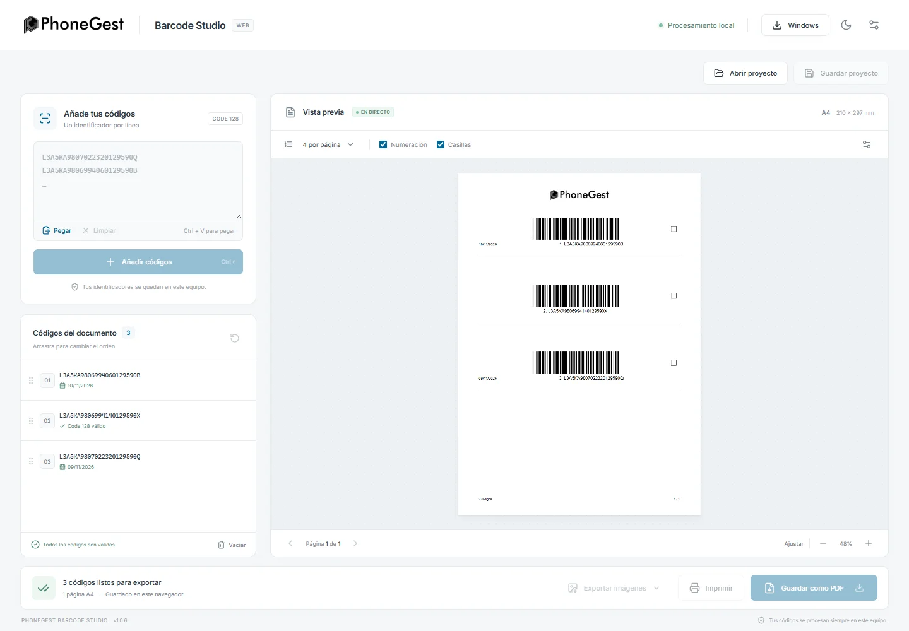
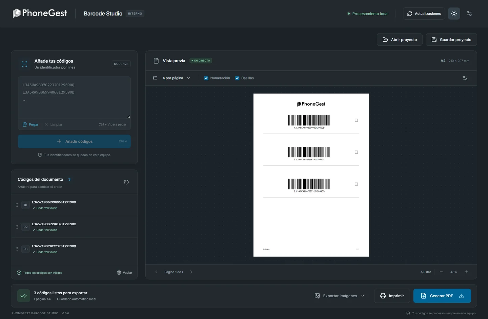
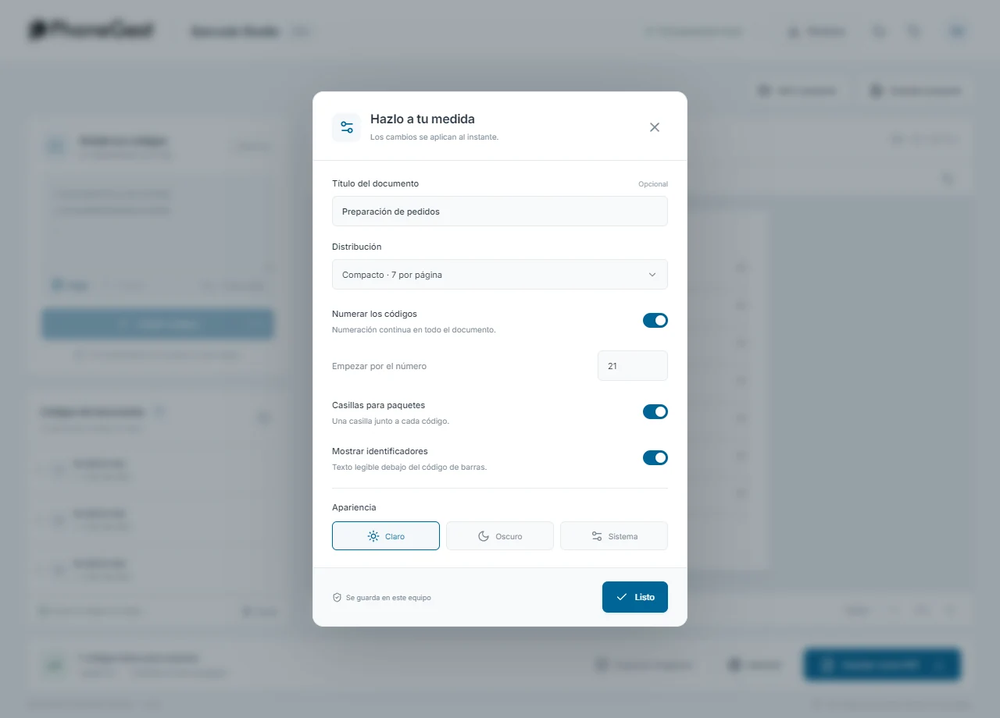
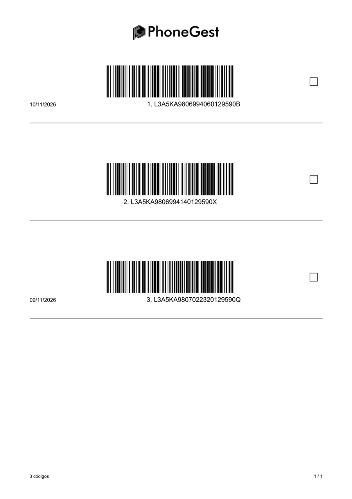
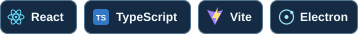

<h1 align="center">&nbsp;PhoneGest Barcode&nbsp;Studio</h1>

<p align="center">
  <strong>Etiquetas Code 128 para web y Windows.</strong><br>
  Prepara lotes, organízalos en hojas A4 y exporta las etiquetas desde tu equipo.
</p>

<p align="center">
  <a href="https://impaul17.github.io/phonegest-barcode-studio/"></a>
  &nbsp;
  <a href="https://github.com/ImPaul17/phonegest-barcode-studio/releases/latest"></a>
</p>

<p align="center">
  <a href="#capturas">Capturas</a> ·
  <a href="#funciones">Funciones</a> ·
  <a href="#primeros-pasos">Primeros pasos</a> ·
  <a href="#tecnologías">Tecnologías</a> ·
  <a href="#desarrollo">Desarrollo</a>
</p>


## Capturas

<table>
  <tr>
    <td width="50%" valign="top">
      <a href="docs/media/studio-web.webp"></a><br>
      <strong>Edición web</strong><br>
      Generación y vista previa en el navegador.
    </td>
    <td width="50%" valign="top">
      <a href="docs/media/studio-windows.webp"></a><br>
      <strong>Edición Windows</strong><br>
      El espacio de trabajo en tema oscuro.
    </td>
  </tr>
  <tr>
    <td width="50%" valign="top">
      <a href="docs/media/studio-settings.webp"></a><br>
      <strong>Configuración</strong><br>
      Distribución, numeración y casillas.
    </td>
    <td width="50%" valign="top">
      <a href="docs/media/studio-export.webp"></a><br>
      <strong>Exportación PDF</strong><br>
      Documento A4 generado en Windows.
    </td>
  </tr>
</table>


## Funciones

| Función | Qué puedes hacer |
| :--- | :--- |
| **Preparar el lote** | Pegar un identificador por línea, editar, reordenar y deshacer cambios. Admite hasta **1.000 códigos** por documento. |
| **Componer el A4** | Revisar los códigos antes de imprimir y elegir entre **PhoneGest (4)**, **Compacto (7)** y **Amplio (2)** por página. Configurar título, numeración y casillas. |
| **Exportar** | Imprimir, generar PDF y crear un **PNG a 300 ppp** por etiqueta. |
| **Continuar después** | Recuperar la sesión local y guardar proyectos **`.pgbs`** compatibles entre web y Windows. |
| **Trabajar a tu gusto** | Elegir tema claro, oscuro o del sistema. El papel de la vista previa se mantiene blanco. |

<details>
<summary><strong>Formato de los códigos y límites</strong></summary>

- Code 128 admite hasta **45 caracteres ASCII imprimibles** por identificador.
- Se omiten las líneas vacías y se recortan los espacios en los extremos. Se conservan mayúsculas, minúsculas, espacios interiores y duplicados.
- Los caracteres Unicode, como las vocales con tilde, y los caracteres de control se rechazan. Puedes corregir el texto antes de añadir el lote.

</details>

## Primeros pasos

### Elige tu edición

<details>
<summary><strong>Web</strong> · abre la aplicación en el navegador</summary>

Abre [Barcode Studio en la web](https://impaul17.github.io/phonegest-barcode-studio/). La sesión se guarda en ese navegador. **Guardar como PDF** abre el diálogo de impresión. La descarga de imágenes es un PNG para un código o un ZIP para varios.

</details>

<details>
<summary><strong>Windows</strong> · instalador y portable</summary>

Para Windows 10/11 x64, elige un archivo de [GitHub Releases](https://github.com/ImPaul17/phonegest-barcode-studio/releases/latest).

- **Instalador** (`*-Instalador.exe`). Permite actualizar desde el menú **Actualizaciones**.
- **Portable** (`*-Portable.exe`). Abre la aplicación directamente. Para actualizar, descarga el portable de la nueva versión.

Ambas ediciones guardan PDF y PNG desde la aplicación.

**Si vienes de una edición anterior a 1.0.4c**, ejecuta una vez el [instalador de la revisión C](https://github.com/ImPaul17/phonegest-barcode-studio/releases/tag/v1.0.4c). A partir de la C, la edición instalada puede recibir las siguientes revisiones con letras. Los ejecutables actuales no tienen firma digital, por lo que Windows puede mostrar un aviso de editor desconocido.

</details>

### Crea tu primer documento

1. Pega los siguientes ejemplos en el campo de códigos y pulsa **Añadir códigos**.
2. Abre **Configuración** para ajustar la distribución, las casillas y la numeración.
3. Revisa la vista previa y elige **Imprimir**, la opción de PDF o **Exportar imágenes**. Guarda el proyecto si vas a reutilizar el lote.

```text
PG-ENVIO-001
PG-ENVIO-002
PG-ENVIO-003
```

Para imprimir, usa **A4 vertical** a **100 %** de escala. En la web, elige **Guardar como PDF** como destino del diálogo si quieres un archivo. Las pruebas leen los códigos exportados con un lector independiente. Para producción, valida también una muestra en la impresora y el lector que vayas a utilizar.

<details>
<summary><strong>Atajos</strong></summary>

| Atajo | Acción |
| :--- | :--- |
| `Ctrl+Enter` | Añadir códigos. |
| `Ctrl+O` / `Ctrl+S` | Abrir / guardar proyecto. |
| `Ctrl+P` / `Ctrl+Shift+E` | Imprimir / generar PDF. |
| `Ctrl+Z` | Deshacer en la lista si el foco está fuera de un campo de texto. |

El botón **Deshacer** conserva hasta 20 cambios durante la sesión. Si el navegador limita el acceso al portapapeles, usa `Ctrl+V` directamente en el campo.

</details>

<details>
<summary><strong>Datos y proyectos</strong></summary>

Los códigos, proyectos y exportaciones se procesan localmente. GitHub aloja la edición web y las descargas de Windows. La edición de escritorio puede procesar los códigos sin conexión.

La sesión incluye el lote, el borrador, la configuración y el tema. En Windows se guarda normalmente en `%APPDATA%\PhoneGest Barcode Studio\session.json`, también al usar el portable. Los proyectos `.pgbs` son archivos JSON sin cifrar. Puedes moverlos entre ediciones y conservarlos junto a tus demás archivos de trabajo.

</details>


## Tecnologías



Ambas ediciones comparten la interfaz y el motor de etiquetas Code 128.

<details>
<summary><strong>Ver todas las tecnologías</strong></summary>

| Área | Tecnologías | Para qué se usan |
| :--- | :--- | :--- |
| **Interfaz** | React · TypeScript · Vite | Espacio de trabajo compartido entre web y Windows. |
| **Etiquetas** | JsBarcode · SVG | Code 128 y documento A4 vectorial. |
| **Edición web** | Canvas · fflate · GitHub Pages | PNG, paquetes ZIP y alojamiento estático. |
| **Edición Windows** | Electron · Sharp · electron-builder · NSIS · electron-updater | Exportaciones, instalador, portable y actualizaciones. |
| **Verificación** | Node.js · Playwright · ZXing · PDF.js | Pruebas del motor, la interfaz y la lectura de las etiquetas exportadas. |

</details>

## Desarrollo

Necesitas **Git**, **Node.js 24** y **npm**. Clona el repositorio y arranca la edición web en local.

```bash
git clone https://github.com/ImPaul17/phonegest-barcode-studio.git
cd phonegest-barcode-studio
npm ci
npm run dev:web
```

En Windows, `npm run dev` abre la edición Electron. Si PowerShell bloquea `npm.ps1`, usa `npm.cmd`.

<details>
<summary><strong>Compilación y pruebas</strong></summary>

| Comando | Resultado |
| :--- | :--- |
| `npm run build:web` / `npm run preview:web` | Compila `dist-web/` y sirve la compilación localmente. |
| `npm run build` / `npm start` | Compila `dist/` y lo abre en Electron. |
| `npm test` | Comprueba motor, proyectos, exportación PNG y actualizador. |
| `npm run test:web` | Prueba la web compilada en Chromium. Ejecuta primero `npx playwright install chromium`. |
| `npm run test:ui` / `npm run test:updates:ui` | Prueba la interfaz de Electron y el flujo de actualizaciones. |
| `npm run smoke`, `npm run test:pdf` y `npm run test:png` | Genera las exportaciones y verifica PDF y PNG con lectura independiente. |
| `npm run package -- --publish never` | Genera instalador y portable x64 en `release/`. |
| `npm run package:dir` | Empaqueta la aplicación en `release/win-unpacked/`. |
| `npm run release:validate` | Verifica el manifiesto, los hashes y el mapa de bloques de la release. |

La interfaz vive en `src/`, el motor compartido en `shared/` y la integración de escritorio en `electron/`. La adaptación para el navegador está en `src/web/`.

</details>

La [edición web](.github/workflows/pages.yml) se despliega desde `main`. La [publicación de Windows](.github/workflows/release.yml) se ejecuta desde tags como `v1.0.4c`. Los pasos de empaquetado, validación y recuperación están en la [guía de publicación](docs/RELEASING.md).


PhoneGest conserva los derechos sobre su nombre, logo e identidad visual. La referencia funcional inicial fue barcodees.com. Consulta los [avisos y licencias de terceros](THIRD-PARTY-NOTICES.txt).
